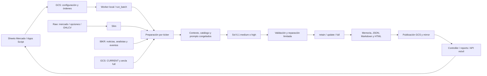

# Arquitectura y estado actual del sistema

Revisión40 activada para nuevas preparaciones el18-10-2026 a las08:17:18 UTC (10:17:18 Europe/Madrid), con lectura de comprobación y sustitución atómica. Publicación manifest-v1, último intento y archivo técnico habilitados; fuentes y tres consumidores compatibles al100%. Configuración SHA25664e54ed9d2e40a47a86538b5af82747ca9f573c00fba0784ee7ca2a28d6ec53e. Mismo Codex local, modelos medium/high, ITV5 y techo6; congelados<=39 intactos.

Punto de entrada actualizado al **18-10-2026**. La [matriz completa](execution_audit_20261017.md) separa correcciones activadas, decisiones metodológicas descartadas e incertidumbres. La [evidencia de puesta en servicio](audit_work_20261017/execution/activation/README.md) registra despliegues, capturas reales, integración y canarios aislados. El checkpoint previo8034b7a y los originales se conservan.

## Propósito y alcance

El sistema ayuda a seguir acciones, revisar el deterioro empresarial y seleccionar zonas de compra en retrocesos. Conserva una tesis y un Setup internos, catalizadores, evento y un plan público con **Entry y Washout opcionales**, cada uno con fortaleza. Desde revisión 35 no selecciona resistencia; desde 29 no produce stops numéricos ni target. Esas retiradas son preferencias de alcance, no evidencia de que el riesgo desaparezca.

El modelo debe separar origen verificable del soporte, vigencia compradora actual, fortaleza y selección. Puede dejar ambas compras vacías; no hay cuota de niveles ni ruptura automática por porcentaje, ATR o cierres. Una zona perdida no se conserva como operación de recuperación. Los cruces marginales no demuestran por sí solos un cambio de plan.

La consistencia de datos, fuentes y cálculos es comprobable; publicar correctamente no valida la utilidad financiera de pesos, umbrales y decisiones. El [cuaderno de estrategia](estrategia_compra_bolsa.md) conserva acuerdos y preguntas de producto; no autoriza implementar reglas nuevas.

## Ruta de lectura

| Necesidad | Documento |
|---|---|
| Último estado documentado e incidencias | [Relevo actual](handoff_current.md) |
| Modelos, contratos, prompts y decisiones | [Motor adaptativo](codex_adaptive_analysis.md) |
| Método financiero real y limitaciones | [Descripción vigente](codex_adaptive_analysis.md#metodología-financiera-vigente-y-límites-de-interpretación), [ampliación metodológica](audit_analysis_system_20261017.md#14-ampliación-qué-conservaríamos-y-qué-rediseñaríamos) |
| Comandos y efectos | [Operaciones](operations.md), [lotes](batch_workflow.md), [ticker individual](standard_analyze_workflow.md) |
| Evidencia, hallazgos y límites | [Auditoría independiente](audit_analysis_system_20261017.md) |
| Propuestas y observaciones pendientes | [Backlog canónico](pending_work_current.md) |
| Componentes y consumidores | [Mapa](component_map.md) |
| Instalación, cola, broker y app | [Instalación](new_computer_setup.md), [cola](command_queue.md), [Gateway](ibkr_gateway_automation.md), [Android](android_app.md) |

`AGENTS.md` conserva sus instrucciones operativas. El texto previo de esta arquitectura está [archivado con contexto](history/architecture_before_audit_20261017.md). «Vigente» en un archivo histórico describe la fecha de esa entrada.

## Configuración y evidencia de ejecución

| Capa | Árbol local | Evidencia disponible y límite |
|---|---|---|
| Motor diario | `config/codex_analysis.json`: revisión 40, production_enabled=true | Activación verificada18-10; los recibos y lotes anteriores mantienen su revisión |
| Mantenimiento | `gpt-6.1-sol`, medium; nombre heredado Luna | Canario LEU40 real, retain y cero reparaciones; Luna no significa otro modelo |
| Full | Mismo modelo, high; petición expresa, ITV o causa crítica | Canario real MRNA40: regenerated, una llamada high,0repair, revisión financiera independiente aprobada; sin publicación |
| Concurrencia | Techo 6 modelos, admisión compartida reduce por saturación; runner máximo 8 | Controles locales de procesos/capacidad; no garantía de capacidad del proveedor |
| ITV | 5 sesiones NYSE para prioridad y seguimiento; solo full reinicia | Fechas Nueva York; no cinco días naturales ni cinco análisis |
| Raw/slim | Fuente40 activa100% | Captura canónica APP verificada18-10, sesiones completas, opciones dirigidas y archivo separado |
| Mercado | Soportes visibles desde 65; sólido desde 70; extensión 36 | Controller publication40 activo; runtime, solid65, extensión y columnas conservados |
| Fuente local | Checkpoint previo `8034b7a`; ejecución posterior sin commit | 681 archivos previos conservados; cinco documentos reconstruidos con la limitación indicada en la matriz |

## Recorrido completo

Este recorrido describe nuevas preparaciones40. Publicación manifest-v1, avisos del intento y archivo técnico están habilitados tras sus comprobaciones. Los contratos congelados mantienen política, prompts, schemas y recibos originales.

| Etapa | Entradas → salidas | Responsabilidad y transformación |
|---|---|---|
| Adquisición técnica | Proveedores de cotización, OHLCV y cadenas Tradier → raw | Indicadores, perfil diario aproximado, reacciones. Muestrea vencimientos y selecciona TOP. Una captura técnica puede escribir su mirror normal: no es una lectura externa sin efectos |
| Slim | Raw → JSON compacto | Reduce candidatos/campos; conserva evidencia, hasta 20 sesiones de mercado completas según calendario, option_details y observaciones dirigidas. No representa todas las opciones ni todos los soportes posibles |
| Fuentes informativas | IBKR/estado local/Finnhub → noticias, acciones de analistas y earnings | Captura completa inmutable por ejecución/ticker/proveedor compartida por noticias, analistas y backfill; una orden nueva vuelve a adquirir. Fechas y EOF originales conservados. Titulares no equivalen a cuerpo completo; agregado no equivale a revisión nueva de cada firma. Investigación web en la misma llamada habilitada |
| Preparación | Slim, noticias, CURRENT, ancla, propiedad → input/política/instrucciones | Comprueba cobertura, sesión esperable y fecha de cada dato antes de congelar. Solicita identidades tipadas de opciones y AVWAP previos |
| Catálogo/contexto | Input lógico → contexto y schema | Identidades por contenido/alcance, agenda de cambios y antecedentes. Un hecho anterior autenticado no es un origen vivo |
| Modelo | Contexto/instrucciones/schema → JSON y eventos | Juicio financiero y materialidad; mantenimiento revisa y actualiza lo rutinario. No sustitución automática de modelo |
| Validación | Respuesta + fuentes/autoridad → candidato o rechazo | Copia hechos, deriva sumas/categorías, comprueba autoridad, origen, continuidad y aritmética aplicable. No demuestra causalidad, rentabilidad ni toda la verdad de la prosa |
| Reparación de mantenimiento | Errores tipados reunidos → una corrección medium | Sin bucle ni full por mero estilo/contrato. Segundo rechazo visible; riesgo e ITV conservan autoridad propia. Full valida una respuesta y falla sin regeneración automática |
| Memoria/ancla | Decisión válida → CURRENT y revisión | Retain conserva finanzas fechadas; update cambia campos autorizados. Full crea ancla. Memoria informativa puede avanzar sin publicar cada investigación |
| Render | semantic_report → MD/HTML y espejos JSON | Desde 15 la estructura precede al texto. Presentación 32/33 selecciona drivers sin borrar historia. Extensión inferior fechada no es stop ni garantía |
| Publicación | Bundle validado → objetos inmutables y manifest por ticker | CAS selecciona una versión completa; descriptor histórico y enlaces fijados. Aliases se reconcilian después. No hay transacción global entre tickers ni con Sheet |
| Consumo | Informes/proyecciones + cotizaciones → Sheet/reportes/móvil | Controller filtra desde 65 y colorea; reports sirve formatos; móvil proyecta lectura. Último intento fallido/pending separado del último informe válido; también se representa el primer fallo sin inventar informe |

## Componentes mantenidos

Los módulos sin prefijo pertenecen a `src/local_runner/`.

| Ruta | Responsabilidad |
|---|---|
| `run_batch.py` | Tres fases concurrentes, checkpoint, reintentos y resumen |
| `adaptive_stage.py` | Preparar, analizar y publicar; flujo individual adaptativo |
| `adaptive_policy.py`, `adaptive_maintenance.py` | ITV, rutas, autoridad y mantenimiento |
| `adaptive_codex.py`, `adaptive_budget.py`, `adaptive_capacity.py`, `codex_call_evidence.py` | Invocación, admisión, presupuesto/recibos, evidencia y tiempos |
| `semantic_report.py`, `semantic_sources.py`, `semantic_binding.py` | Contrato, fuentes e integridad durante validación |
| `volume_arithmetic.py`, `volume_rubric.py`, `reaction_comparison.py` | Cálculos, herencia, dirección y metodología versionada |
| `adaptive_current.py`, `analysis_state.py`, `review_memory.py` | CURRENT, ancla y memoria |
| `publication_bundle.py`, `publication_store.py`, `publication_authority.py`, `analysis_attempt.py` | Versión inmutable, CAS, autoridad e intento separado |
| `publication_auth.py` | ADC por defecto o puente GCloud explícito de cuenta/proyecto; no cambia el motor Codex |
| `technical_archive.py`, `archive_technical_observations.py` | Investigación fuera del contexto del modelo; reutiliza lo ya descargado |
| `reader_report.py`, `catalyst_editorial.py`, `support_validity.py` | Presentación y metadatos visuales |
| `gcp_functions/support_resistances_raw/`, `support_resistances_slim/` | Fuentes técnicas mantenidas; `incoming_from_gcp/` es histórico |
| `gcp_services/stock_controller/` | Mercado, cotizaciones, layout, cartera y sincronización |
| `gcp_functions/reports_reader/`, servicios móviles | Lectores de informes y API móvil; rutas concretas en [Android](android_app.md) |
| `apps_script/` | Interfaz, cola y espejos en Sheets; no modelos ni IBKR |
| `android/` | Cliente Growth, sin autoridad financiera sobre el análisis |

El árbol local no prueba el contenido de la imagen desplegada. Los parches cloud partieron de imágenes activas concretas. A1 conservó runtime salvo imagen; A2 añadió EVALUATION_ARCHIVE_ENABLED en raw y fijó RAW_BASE_URL canónico en slim, conservando el resto. No confundir ese artefacto con el checkpoint previo ni con las modificaciones locales posteriores.

## Estado, fuentes y fechas

- Trabajo adaptativo: `logs/batch/<fecha>/<hora>/adaptive/<TICKER>/`; individuales: `logs/adaptive_individual/`. Contienen input, política, instrucciones, schemas, responses, receipts, eventos y review/failure.
- `output/<TICKER>/latest.*` es copia local de trabajo/resultado; no sustituye el estado publicado ni el original congelado del lote.
- GCS almacena `<TICKER>/latest.{md,json,html}`, snapshots/historial y estado de ancla/CURRENT. Las URIs exactas las construyen `analysis_state.py` y `adaptive_current.py`; el mirror de consumidores es otra ubicación.
- `generated_at` fecha finanzas; `reviewed_at` puede avanzar sin full; ITV se calcula desde `generated_at` del ancla full; `last_full_report_at` refleja esa época y recovery conserva la ITV original autenticada. `as_of` técnico es hora de captura, no fecha de cada dato.
- Recibos congelados mantienen revisión, prompt, schema y política. Un input 39 no convierte un recibo 38 en 39; una corrección del validador no autoriza editar originales.
- Individuales/manuales: propiedad desde Mercado (`tickers_market.json`) u override explícito. Lotes de universo seleccionado conservan sus booleanos explícitos; ausentes/no booleanos se resuelven con Mercado. Se mantienen fuente de selección y de tenencia separadas en input. Desconocido/duplicado ambiguo falla; no equivale a owned=false.

## Límites abiertos

Las correcciones de volumen intradía, unidades, opciones sin gamma, cobertura IBKR, integridad/frescura, geometría y publicación están implementadas y activadas con sus pruebas. La puesta en servicio añadió correcciones verificadas de UTF-8, tiempo de respuesta IBKR, paginación real, aviso de fallos tempranos y fuente de tenencia. El [informe de ejecución](execution_audit_20261017.md) conserva evidencia y límites de cada punto.

La ampliación metodológica reconstruye también límites de selección de candidatos, reacciones sin recorrido adverso completo, opciones sin inventario dealer, pesos no calibrados y contexto de mercado/eventos parcialmente integrado. Hay oportunidades de simplificación y mejor representación antes de añadir señales. Los datos publicados y los ejemplos ex ante no prueban ventaja predictiva; se ejecutaron las comparaciones locales de candidatos, trayectorias, ablaciones, contexto y cadencia descritas en la matriz. Las carencias temporales impiden una confirmación predictiva.

«Validado» significa que pasó los controles implementados. No demuestra que todos los supuestos estén comprobados. El [backlog](pending_work_current.md) separa implementación local, activación externa, descartes e incertidumbres. La configuración40 y las cinco revisiones de servicio fueron activadas; modelos, ITV5, criterios de puntuación y originales se conservan. El próximo lote natural debe medir comportamiento agregado, reparaciones y tiempos sin duplicarlo para obtener una cifra de éxito.
