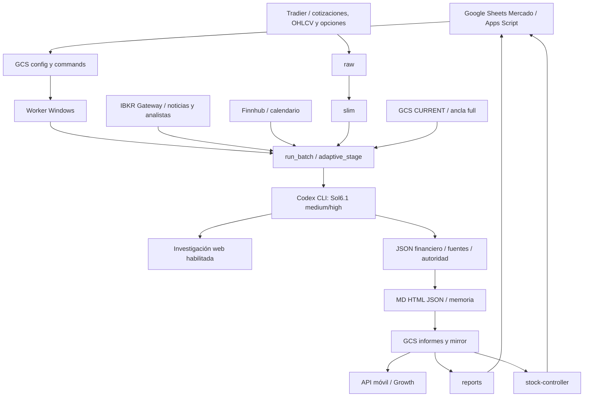

# Mapa de componentes vigente

Mapa 17-10-2026 del código y evidencia local; no inventario remoto recién consultado. Descripción y límites: [arquitectura](architecture.md). El [mapa04-09](history/component_map_before_audit_20261017.md) queda como antecedente.

## Responsabilidad

| Componente | Decide o conserva | No acredita por sí solo |
|---|---|---|
| Sheets/Apps Script | Universo, propiedad registrada, órdenes, interfaz | Análisis financiero ni estado actual de cada proveedor |
| Worker/runner local | Contratos, rutas, fuentes, validación, publicación | Juicio predictivo correcto |
| Raw/slim | Datos y medidas con muestreo/fechas | Cobertura universal ni vigencia compradora |
| Modelo medium/high | Juicio, materialidad, selección y explicación | Autenticidad durable de un archivo reabierto |
| Ancla full | Época de revisión completa | Que todo dato histórico siga vivo |
| CURRENT/memoria | Juicio mantenido y revisiones autenticadas | Nuevo full por cada retain |
| Renderer | Espejos y presentación | Veracidad semántica completa de la narrativa |
| Controller/reports/móvil | Proyección al lector | Atomicidad de todos los formatos ni intento fallido ausente |

## Secuencia de una orden

1. El menú exporta el universo correspondiente y encola una acción admitida.
2. Worker reclama orden bajo lock local y despacha ticker/lista; acciones de cartera son otra ruta.
3. Fuentes/preparación congelan contexto, política, instrucciones y schema.
4. El modelo devuelve JSON; código valida y, si corresponde, permite una reparación o full por causa propia.
5. Retain/update/full conservan o renuevan la época de acuerdo con su autoridad.
6. Bundle se publica secuencialmente; estado y consumidores se sincronizan.
7. Orden, checkpoint, review/failure y progreso registran el resultado. No todos los lectores reciben aún el estado de último intento.

## Ubicaciones

`src/local_runner/` es el motor local; `gcp_functions/support_resistances_{raw,slim}/` son fuentes técnicas; `gcp_services/stock_controller/` presenta Mercado; `gcp_functions/reports_reader/` sirve informes; servicios móviles/cliente en [Android](android_app.md). `incoming_from_gcp/` es referencia histórica.

GCS almacena configuración/cola, latest/snapshots, ancla y CURRENT, además del mirror del consumidor. Las URIs se construyen en código: no deducirlas de nombres históricos. La [guía operativa](operations.md) distingue lecturas, capturas que escriben mirror, publicaciones y despliegues.
