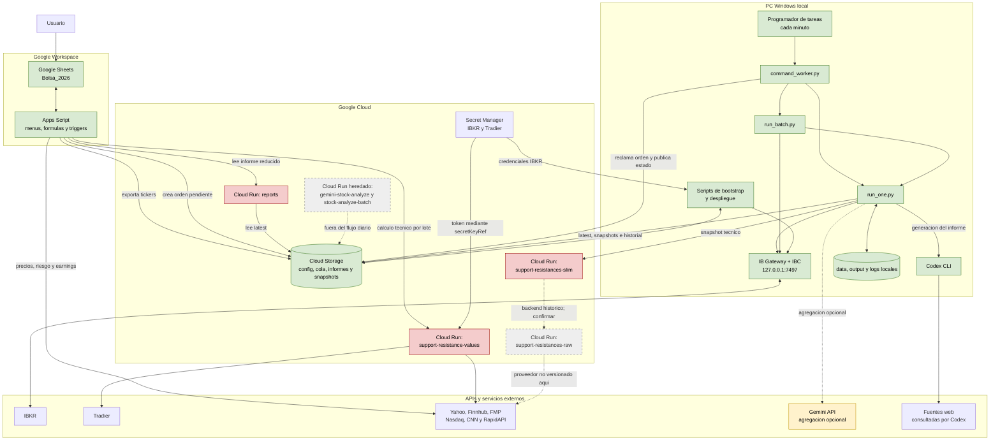
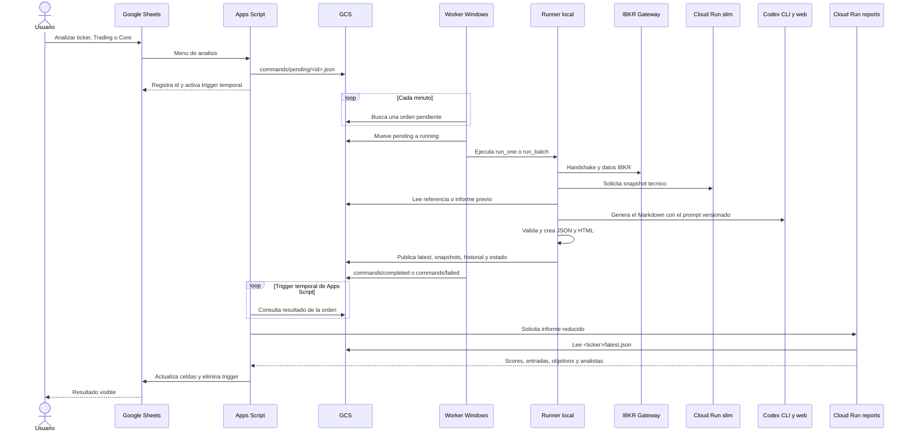

> Archivo histórico preservado el 17-10-2026. Sus referencias a «actual», «vigente» o «siguiente» corresponden a la fecha de cada entrada. No es una guía de ejecución vigente. Consulte [arquitectura actual](../architecture.md), [relevo](../handoff_current.md) y [backlog](../pending_work_current.md). Se ajustaron únicamente rutas relativas de enlaces al archivar.

# Mapa de componentes

Este documento representa el sistema observado el 2026-09-04. La hoja de calculo
es **Google Sheets**; no se detecto una integracion activa con Microsoft Excel.

## Topologia general



Leyenda:

- verde: componente activo bajo control local;
- rojo: componente activo expuesto a Internet o con un hallazgo de seguridad;
- amarillo: ruta opcional;
- gris discontinuo: servicio heredado o relacion pendiente de confirmar.

## Secuencia de una orden desde la hoja



## Objetos principales en GCS

```text
config/
  tickers.json
  tickers_core.json
commands/
  pending/  running/  completed/  failed/
  status/latest.json
batch/status/
  latest_trading.json
  latest_core.json
<TICKER>/
  latest.md
  latest.html
  latest.json
  <fecha>/<hora>.{md,html,json}
  history.json
_analysis_state/<TICKER>/reference.json
_local_test/<TICKER>/latest.*
bootstrap/ibkr/
  latest.json
  <version>/...
```

## Responsabilidad por componente

| Componente | Responsabilidad | Fuente de verdad |
| --- | --- | --- |
| Google Sheets | Interfaz y cartera visible | Hoja `Bolsa_2026` |
| Apps Script | Comandos, formulas, refrescos y sincronizacion | `apps_script/` mas propiedades remotas |
| Worker local | Consumo de la cola y despacho | `src/local_runner/command_worker.py` |
| Runner local | Politica, generacion, validacion y publicacion | `src/local_runner/` y `prompts/` |
| IBKR Gateway | Datos IBKR y sesion de broker de solo lectura | Proceso local y Secret Manager |
| GCS | Bus asincrono y almacenamiento durable | `stock-analysis-reports-naxo85` |
| Cloud Run `reports` | Adaptador de informes para la hoja | `gcp_functions/reports_reader/` |
| Cloud Run tecnico | Snapshots y metricas de mercado | Fuente parcial en este repositorio |
| APIs externas | Precios, noticias, eventos y sentimiento | Cada proveedor externo |

